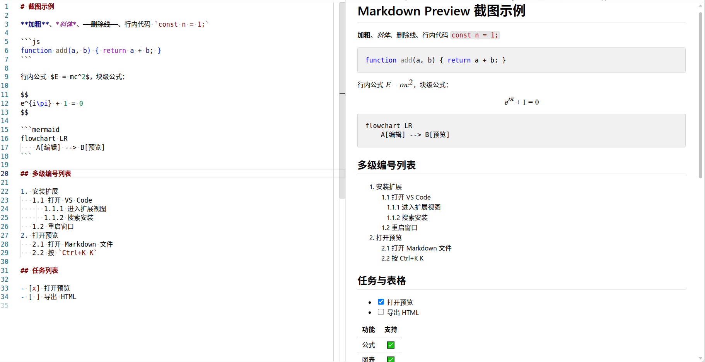
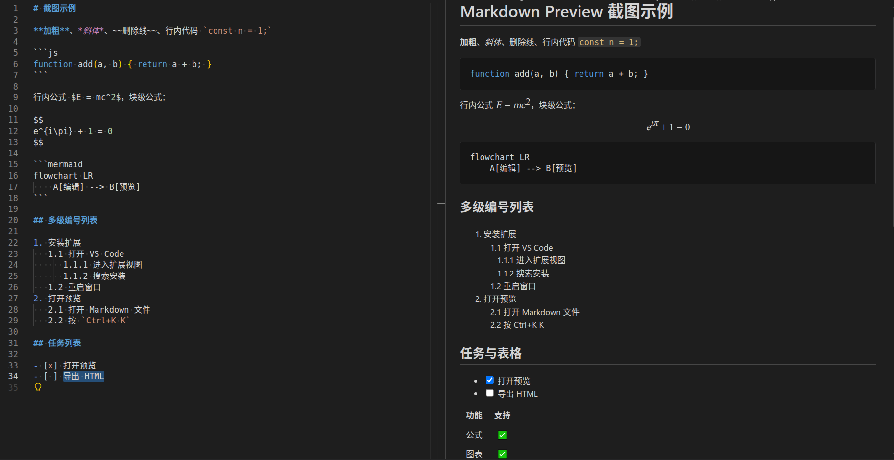
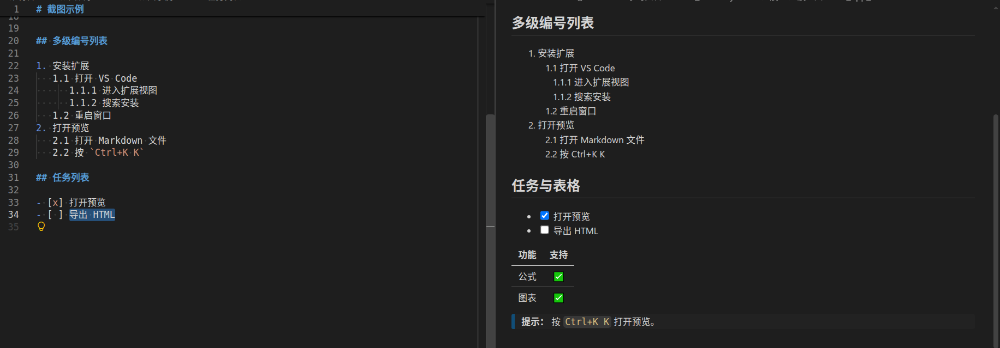

# Markdown CommonMark Preview & Editing

> CommonMark 风格的 Markdown 预览，双向滚动联动与 VS Code 内置预览完全一致；同时内置加粗、斜体、删除线、列表、任务、目录、表格格式化等常用编辑命令，让 Markdown 写作更高效。


- 预览为独立的 Webview 窗口，主题跟随 VS Code 深色 / 浅色自动切换，无闪烁
- 编辑与预览双向滚动联动，定位精准、跟动流畅
- 数学公式、mermaid 图表、代码高亮、任务列表开箱即用
- 内置常用 Markdown 编辑命令，快捷键与主流编辑器习惯保持一致

---

## 功能特性

### 预览

- 主题完全跟随 VS Code 内置 Markdown 预览（`--vscode-*` 变量），深色 / 浅色自动切换，无闪烁。
- 双向滚动联动与 VS Code 内置预览完全一致：行级插值定位、代码块内逐行映射、50ms 节流连续跟动、双方向防循环抑制。
- 滚动联动仅在预览与编辑器并排时生效（同窗口堆叠时不联动）；同一文件在多个并排窗口打开时，滚动预览会带动所有窗口一起联动。
- 打开预览自动定位到编辑器当前行；图片加载完成后再定位，避免漂移。
- 预览支持搜索：按 `Ctrl+F`（macOS `Cmd+F`）打开与内置 Markdown 预览一致的查找控件，支持上一个 / 下一个、匹配高亮与计数、`Enter` / `Shift+Enter` 切换、`Esc` 关闭。
- 预览标签页使用专属图标（文档 + 放大镜），与普通 Markdown 文件标签区分。
- 支持扩展名：`.md` `.markdown` `.mdx` `.mdown` `.mkd` `.rmd` `.qmd` `.txt`。

### 编辑命令

| 命令 | 默认快捷键 | 说明 |
|------|-----------|------|
| Toggle Bold | `Ctrl+B` | 加粗 `**` / `__` |
| Toggle Italic | `Ctrl+I` | 斜体 `*` / `_` |
| Toggle Strikethrough | `Alt+S` | 删除线 `~~` |
| Toggle Code Span | `` Ctrl+` `` | 行内代码 `` ` `` |
| Toggle Code Block | - | 代码块 |
| Toggle Math | `Ctrl+M` | 行内 / 块级数学公式 |
| Toggle List | - | 列表项 `-` 切换 |
| Toggle Task List | `Alt+C` | 勾选 / 取消任务 |
| Create / Update TOC | - | 生成 / 更新目录 |
| Format Table | - | 表格对齐格式化 |
| Print to HTML | - | 导出 HTML（带主题） |

> macOS 上快捷键使用 `Cmd` 代替 `Ctrl`。

### 渲染能力

- 数学公式（KaTeX，`markdown-it-texmath`）
- 图表（mermaid：flowchart / sequence / gantt / class / state / pie / er / journey / gitGraph / mindmap / timeline）
- 代码高亮（highlight.js，跟随主题）
- 任务列表（`markdown-it-task-lists`）

---

## 截图







---

## 快速开始

安装扩展后，用以下任意一种方式打开预览：

| 方式 | 操作 |
|------|------|
| 快捷键 | `Ctrl+K K`（macOS `Cmd+K K`）直接打开预览 |
| 资源管理器右键 | Markdown 文件 → `预览` |
| 编辑器标题栏 | 点击预览图标 |
| 编辑器右键 | `预览` |
| 打开方式 | 任意 Markdown 文件 → 打开方式 → `Markdown CommonMark - 编辑 / 预览` |

打开位置说明：

- `Ctrl+K K` 与编辑器标题栏图标：在**当前窗口右侧并排**打开预览。
- 资源管理器 / 编辑器标签页右键：在**当前窗口内**打开预览（与文件堆叠，不弹出并排窗口）。
- 任一入口打开时，若对应窗口已存在该文件的预览，则**直接激活已有预览**，不会重复新建。

### 安装

从 VSIX 安装（适用于内部分发）：

```
code --install-extension markdown-commonmark-preview.vsix
```

或在扩展视图 → `...` → 从 VSIX 安装。

---

## 扩展设置

| 配置项 | 默认值 | 说明 |
|--------|--------|------|
| `markdown-commonmark-preview.bold.indicator` | `**` | 加粗标记 |
| `markdown-commonmark-preview.italic.indicator` | `*` | 斜体标记 |
| `markdown-commonmark-preview.toc.levels` | `1..6` | 目录标题层级 |
| `markdown-commonmark-preview.tableFormatter.enabled` | `true` | 表格格式化开关 |

完整的配置项可在扩展设置页面（`Ctrl+,` → 搜索 `markdown-commonmark-preview`）中查看和调整。

---

## 已知限制

- 预览为独立 Webview（非内置预览叠加），不参与内置 `markdown.*` 配置。
- 代码折叠（DETAILS）、diff 高亮、`scrollProgress` 恢复暂未实现（不影响常规使用）。

---

## 发布说明

最新版本变更详见 [CHANGELOG.md](./CHANGELOG.md)。

- **0.2.10**：修复预览不随编辑实时更新的问题：编辑器中修改 Markdown 后预览立即刷新（含删除列表项等场景），行为与 VS Code 内置 Markdown 预览一致。
- **0.2.9**：滚动联动仅在并排窗口时生效，同一文件多窗口并排时一起联动；右键预览改在当前窗口打开且已有则激活；预览标签页新增专属图标。
- **0.2.7**：预览支持搜索（`Ctrl+F` / `Cmd+F`），查找控件与内置 Markdown 预览一致。
- **0.2.6**：修复插件激活时报错的问题（`contributes.colors` 颜色 id 含非法字符连字符，已改为仅字母数字点的规范命名）。
- **0.2.5**：首个正式版本，提供 CommonMark 风格预览、双向滚动联动及常用编辑命令。

---

## 许可证与第三方声明

本扩展基于 [MIT License](./LICENSE) 开源发布。

预览渲染能力基于开源库 KaTeX / mermaid / highlight.js / markdown-it 等构建，第三方来源与许可证声明详见随包附带的 [THIRD_PARTY_NOTICES.md](./THIRD_PARTY_NOTICES.md)。
