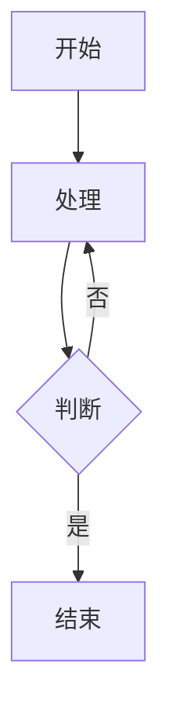

<!-- title: 导出功能验收样例 -->

# 第一章 概述

## 1.1 背景

这是一个**导出验收样例**，包含 *斜体*、`行内代码`、~~删除线~~、[外链](https://example.com)。

> 这是一段引用文字。

## 1.2 数学公式

行内公式 $E = mc^2$ 和块级公式：

$$
\int_0^\infty e^{-x^2} dx = \frac{\sqrt{\pi}}{2}
$$

# 第二章 内容

## 2.1 表格

### 2.1.1 三级标题示例

| 列A | 列B | 列C |
| --- | --- | --- |
| 1 | 2 | 3 |
| 4 | 5 | 6 |

## 2.2 代码块

```python
def hello(name):
    print(f"Hello, {name}")
```

```javascript
const x = 1;
console.log(x);
```

## 2.3 任务列表

- [x] 已完成
- [ ] 未完成

## 2.4 Mermaid 图（fenced）



## 2.5 Mermaid 图（container）

:::mermaid
sequenceDiagram
    Alice->>John: Hello John, how are you?
    John-->>Alice: Great!
:::

## 2.6 图片


## 2.7 GitHub Alert

> [!NOTE]
> 这是一个注意提示。

# 第三章 结语

参考 [另一份文档](./other.md)。
